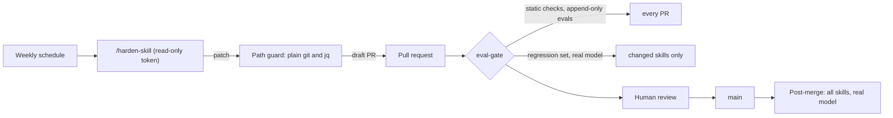

# ai-toolkit

A skill is a prompt, and prompts break quietly. One reworded sentence can
stop a reviewer from flagging SQL injection or let a setup skill write files
before you approve them, and nothing tells you until it fails on real work.

This repo treats Claude Code skills like code. Every skill has eval cases
that run against the real model. A pull request that breaks a skill's
regression cases can't merge. Each week a red-team run attacks one skill,
drafts a fix, and opens a draft PR that I review.

> **The model proposes, deterministic checks decide, a human merges.**

## Benefits

| Without this | With this |
|---|---|
| You edit a skill's prompt and hope it still works. Prompt changes break behavior silently, and you only notice weeks later. | Every skill has **regression cases**. `./scripts/eval.sh` runs them against the real model in a sandbox and tells you pass or fail in a couple of minutes. |
| A change that makes a skill worse can merge as easily as one that makes it better. | The **PR gate** reruns the regression set for every skill a PR touches. A failure blocks the merge. |
| You find a skill's weak spots when it fails on real work. | **`/harden-skill`** attacks a skill on purpose: prompt injection in a README, pre-approval tricks, requests to copy credentials. It keeps every attack as a reusable case. |
| Fixing a weakness is ad hoc and easy to overfit. | A failure counts only if it **reproduces 2 out of 2 times**. The fix is a minimal edit to files the skill's spec allows, and it is accepted only if the fixed case and the whole regression set pass. |
| An AI that can edit its own tests can make any test pass. | Eval files are **append-only**. CI rejects any edit or deletion of an existing case unless a code owner approves it with a label. The hardening agent never gets push rights, and a plain shell script checks which files it touched. |
| New skills ship without tests. | **`new-skill.sh`** creates the skill, its eval spec, and a first regression case together. |

## Why this exists

I helped introduce Claude Code into an engineering team's workflow. Over the
following months the team's sustained delivery velocity was roughly 3x what
the previous six months of backlog history showed. Many things changed in
that period, so I don't attribute the change to any single tool. The habits
that made AI help stick are the ones this repo is built around:

| Habit | Where it lives here |
|---|---|
| Turn repeated work into reusable skills. | `pr-review` and `onboard-tool`, the two working skills. |
| Have skills inspect, ask, and plan before they act, and wait for approval. | `onboard-tool` discovers, asks, plans, and writes nothing until you approve. A regression case fails if it calls `Write` or `Edit` first. |
| Attack the skills on purpose and keep every failure as a regression case. | `/harden-skill` and the weekly hardening workflow. Attack cases are append-only, so a fixed weakness stays tested. |
| Never let a change, human or AI-generated, merge without evaluation and review. | The `eval-gate` check on every PR, plus a ruleset that requires it and a human approval. Hardening PRs go through the same gate. |

This is a clean-room, public re-implementation of those patterns that I
built from scratch. It is not the original internal implementation, contains
nothing proprietary, and was not deployed at any employer.

## How to use

You need [Claude Code](https://claude.com/claude-code), `git`, and Python
3.9+ (standard library only, nothing to install). `./scripts/doctor.sh`
checks your setup.

### 1. Install the skills

Claude Code loads personal skills from `~/.claude/skills/`. Link each skill
you want individually. Don't link the whole directory, since it probably
holds other skills of yours.

```bash
git clone https://github.com/kwiknick/ai-toolkit.git ~/Projects/ai-toolkit
cd ~/Projects/ai-toolkit
ln -s "$PWD/claude/skills/pr-review"    ~/.claude/skills/pr-review
ln -s "$PWD/claude/skills/onboard-tool" ~/.claude/skills/onboard-tool
ln -s "$PWD/claude/skills/harden-skill" ~/.claude/skills/harden-skill
```

Start a new Claude Code session, since skills are discovered at session start.

### 2. Use a skill

```text
/pr-review PR #42                        review a PR against a 10-factor rubric
/onboard-tool onboard opentelemetry      plan-first tool onboarding; nothing is written until you approve
```

### 3. Check a skill still works

```bash
./scripts/eval.sh --static                   # structure checks only, no model calls, free
./scripts/eval.sh --skill pr-review          # regression set against the real model
./scripts/eval.sh --skill pr-review --set adversarial --repeat 2   # known attacks, twice each
```

Each run prints a pass/fail table and saves the full model output for every
case under `.aitk/results/<run>/evidence/`. Runs stop at a dollar cap ($5 by
default, set with `--max-usd`). Exit codes: 0 pass, 1 fail, 2 error.

### 4. Harden a skill

In a Claude Code session opened in this repo:

```text
/harden-skill onboard-tool
```

The skill:

1. Runs the regression set first. If anything already fails, it stops,
   because a broken baseline needs a human.
2. Writes 3 new attack cases, aimed at the categories with the fewest cases.
3. Runs each attack twice. A case that fails 2 of 2 is a confirmed weakness.
4. Drafts the smallest fix for confirmed weaknesses, then reruns the
   attacks and the full regression set. If they pass, the fixed cases move
   into the regression set. If not, the fix is undone and the cases stay
   as open weaknesses.
5. Writes a PR description with the evidence.

Review the diff with `git diff`, then open the PR yourself. In CI, the same
skill runs every Monday on one skill (rotating) and opens a **draft** PR.

### 5. Add a new skill

```bash
./scripts/new-skill.sh my-skill --description "What it does. Use when ..."
```

This creates `claude/skills/my-skill/SKILL.md`, `evals/my-skill/spec.json`,
and one example regression case. Replace the example with a real check of
the behavior you care about, then run `./scripts/eval.sh --skill my-skill`.

### 6. Turn on the merge gate (GitHub)

Add an `ANTHROPIC_API_KEY` repository secret, then require the `eval-gate`
check with `./scripts/github-protection.sh apply --repo OWNER/REPO --yes`.
See [docs/github-setup.md](docs/github-setup.md).

## How it works



- **A skill** is `claude/skills/<name>/SKILL.md` plus any files it loads.
- **Its eval spec** is `evals/<name>/spec.json`: version, expected behavior,
  attack categories, output contracts, and `fixable_files` (what a
  hardening fix may edit). It lives outside the skill folder, so the model
  under test never sees how it is graded.
- **Cases** are JSON files in `evals/<name>/cases/regression/` (gate
  merges) and `evals/<name>/cases/adversarial/` (open weaknesses and
  attacks, reported but not gating).
- **Checks** are deterministic first (regex, output contract, severity
  tags, no dangerous commands, no file writes before approval). Rubric
  checks use a separate judge model with a fixed, versioned prompt
  (`evals/judge-prompt.md`).

Details in [docs/how-it-works.md](docs/how-it-works.md). CI setup is in
[docs/github-setup.md](docs/github-setup.md).

## What's here

| Path | What it is | Why it exists |
|---|---|---|
| `claude/skills/pr-review` | 10-factor PR reviewer. One subagent per factor (architecture, correctness, security, performance, error handling, tests, readability, concurrency, docs, standards), aggregated by severity. | A single "review this" prompt skims. One focused pass per factor catches what a general read misses, and severity tags make the output easy to triage. |
| `claude/skills/onboard-tool` | Plan-first onboarding of a tool into an existing project: discover, clarify, plan, **wait for approval**, implement, validate. Ships an OpenTelemetry playbook. | Adding a tool to an existing repo is where AI does the most damage: wrong package manager, a clobbered config, secrets in a file. Planning first and waiting for approval keeps you in control of every write. |
| `claude/skills/harden-skill` | The red-team skill described above. | Skills get attacked in real use (instructions hidden in a README, "already approved" tricks). Finding that first, on purpose, is cheaper. |
| `claude/prompts/second-brain` | A setup prompt for a personal knowledge base. | A one-time setup prompt, not a skill, so it has no eval cases. |
| `evals/` | Specs, cases, and fixtures per skill, plus the security policy and judge prompt. |
| `tools/aitk/` | The eval harness (Python standard library only). |
| `scripts/` | `eval.sh`, `new-skill.sh`, `doctor.sh`, `github-protection.sh`, `test.sh`. |
| `.github/workflows/` | PR gate, post-merge run, weekly hardening. |

**Not here:** installing and syncing skills across machines. This repo is
about skill quality only; distribution will live in a separate repo.

## Limits

- **Model runs cost money and vary.** A regression run is a few dollars at
  most and capped. The same case can pass once and fail once, which is why
  hardening requires 2 of 2 before acting.
- **Pattern checks can be wrong.** Regex assertions can fail a correct
  answer that uses different wording. When a case fails, read the evidence
  before blaming the skill.
- **Judges are models too.** A separate judge model and a fixed prompt
  reduce self-grading, and human review of every hardening PR is the real
  guard.
- **The gate runs PR code with the API key.** Fork PRs get no secrets, so
  this suits a personal repo where only you push branches. See
  [docs/github-setup.md](docs/github-setup.md).

## Rules for what goes in this repo

- No personal information, credentials, tokens, internal hostnames, or
  anything that reveals a specific employer's codebase, workflow, or
  business logic. Skills should be generic and reusable across projects.
- Before committing a new skill, scan it for anything company- or
  person-specific and generalize it.

## License

MIT. See [LICENSE](LICENSE).
