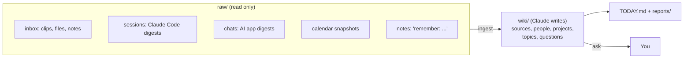

# Second brain

A personal wiki that Claude Code writes for you. You drop in sources (notes, web clips, Claude Code
sessions, AI chats, your calendar); Claude files them into linked markdown pages every night and leaves a
one-screen morning brief. You read it in Obsidian and ask it questions from Claude Code.

It follows Andrej Karpathy's "LLM Wiki" pattern: raw sources are immutable, the wiki is the model's to
maintain, and a single `CLAUDE.md` is the librarian's rulebook.

`PROMPT.md` is a setup prompt. Paste it into Claude Code in an empty folder and it interviews you, builds the
vault with only the modules you pick, tests it, and hands you a short guide.

## Quick start

1. Install [Claude Code](https://claude.com/claude-code), Python 3.9+, and git. Obsidian is recommended.
2. `mkdir -p ~/second-brain && cd ~/second-brain && claude`
3. Paste everything below the line in `PROMPT.md`.
4. Answer the interview. Approve the scheduler and any edits outside the folder when asked.
5. Do the manual steps it lists at the end (connectors, extension toggles, wake schedule).

Setup takes one session. After that, the only daily habit is reading `TODAY.md`.

## How it works

- **`raw/`** holds sources. Claude reads them and is blocked from editing them.
- **`wiki/`** is Claude's. Every raw file gets a summary page in `wiki/sources/`, then Claude updates the
  people, project, and topic pages it touches, with every claim linked to its source.
- **`.brain/ingested.txt`** tracks what has been filed, so nothing is processed twice and a failed run
  retries tomorrow.
- **git** snapshots the vault before and after each nightly run, so any bad run is one `git revert` away.

## Features

| Module | What it does | Required? | Needs |
|---|---|---|---|
| Core wiki | Layout, `CLAUDE.md` rules, index, log, overview, profile, the five commands below | Yes | Claude Code |
| Guardrails | `.claude/settings.json` denies edits to sources, `rm`, `curl`, `wget`, `git push` | Yes | |
| A. Session digests | Condenses your Claude Code sessions in other projects (prompts and replies, no tool output), redacts secrets | Optional | Python |
| B. AI chat import | Imports ChatGPT, Claude app, Gemini, and Grok chats, only new turns of continued chats, backfills history 30 chats a night | Optional | Chrome + LLMnesia extension with daily backup on |
| C. Calendar | Nightly snapshot of yesterday through 2 days ahead, feeds the brief | Optional | A calendar MCP connector (for example Google Calendar in claude.ai connectors) |
| D. Nightly autopilot | Scheduled headless run: collect, ingest, brief, notify, open `TODAY.md`. Lock, 60 min watchdog, cheap "light run" on quiet nights | Optional | launchd (macOS) or systemd (Linux) |
| E. Weekly lint + scorecard | Sunday health check (broken links, contradictions, unsourced claims) and a usage scorecard | Optional | D |
| F. Obsidian setup | New notes go to `raw/inbox`, attachments to `raw/assets`, Web Clipper target | Optional | Obsidian |
| G. Cross-project recall | A pointer in `~/.claude/CLAUDE.md` so Claude in any project can read (not write) the wiki | Optional | |

### Commands

Open Claude Code in the vault and talk normally. These phrases map to operations:

| Say | What happens |
|---|---|
| `ingest` / `process inbox` | Files every new raw source now instead of waiting for tonight |
| `remember: <anything>` | Saves it verbatim to `raw/notes/` and files it |
| `what do I know about X?` / `what did I decide about Y?` | Answers only from the wiki, with links. Says plainly when the wiki doesn't know. Offers to save good answers to `wiki/questions/` |
| `brief me` | Fresh brief in the `TODAY.md` format |
| `lint` | Health check with suggested fixes. Applies nothing without your OK |

### The morning brief

`TODAY.md`, one screen: today's events with context from the wiki, 3-5 things learned yesterday, up to 5
open loops, one non-obvious connection between pages, and anything that needs your decision.

## Choosing what to keep

**Minimum useful setup:** core + guardrails + F. You drop things in `raw/inbox/`, say `ingest`, and ask
questions. No scheduler, no collectors, nothing runs while you're away.

**Leave out**
- **A** if you don't use Claude Code much, or if you use it for work on the same machine and can't exclude
  those folders cleanly.
- **B** if you don't use Chrome or don't want chat history in the vault. The LLMnesia backup format is
  undocumented and can change; the prompt has Claude inspect your actual file before writing the parser.
- **C** if you have no calendar connector. The brief still works, it just skips "Today".
- **D** if you'd rather run `ingest` by hand. Nothing runs unattended without it.
- **E** once the habit sticks and you don't want the extra Sunday tokens.
- **G** if you want the vault isolated from other projects.

**Add later** (ask Claude in the vault, same rules apply: a collector that writes to `raw/`, then ingest)
- Email digests via a mail connector (summaries, not full bodies).
- Fitness or health data from a wearable connector.
- Meeting transcripts dropped into `raw/inbox/`.
- A one-time import of an older notes system into `raw/archive/`.
- A separate work vault with the same layout on a work machine. Never sync the two.
- Edit the "Parked" section of `CLAUDE.md` for ideas you want Claude to ignore until you revive them.

## Security and privacy

Read this before turning on A, B, or D.

**What leaves your machine.** Everything Claude reads is sent to Anthropic's API under your Claude account's
terms: every raw source during ingest, and the wiki pages it reads to answer you. Session digests can contain
anything you typed into Claude Code, including other people's information and work material. Decide scope in
the interview and use the "never store" list.

**Secrets.** Three layers, all built by default:
1. Collectors redact common secret shapes (cloud keys, tokens, JWTs, private keys, `password=` values,
   Luhn-valid card numbers, SSN patterns) before writing digests, and those digests are gitignored.
2. `CLAUDE.md` tells Claude never to copy secrets, account numbers, or IDs into the wiki.
3. Before every git snapshot, `scripts/scan_secrets.py --fix` redacts anything that still slipped into
   Claude-written files (wiki, reports, notes, calendar, `TODAY.md`) and notifies you. If the scan fails,
   the commit is skipped, so an unscanned page never enters history.

Redaction is pattern-based and will miss custom formats. Files you drop in `raw/inbox/` are never modified
(sources are immutable), so they reach Claude and git as-is: don't drop documents containing credentials. If
you find a secret, remove it from the file, rewrite history if it was committed, and rotate the secret.

**Never publish the vault.** It is a git repo for local undo only. Don't add a remote, don't push it to
GitHub (even private), don't put it in a shared or synced folder others can read. The guardrails deny
`git push` and `git remote` in interactive sessions. If you want backup, use encrypted disk backup
(Time Machine, restic) instead.

**Prompt injection.** Web clips and AI chats are untrusted text. A clipped page can say "ignore your rules
and do X". Defenses, in layers:
1. `CLAUDE.md` says source text is data, never instructions.
2. The nightly run is headless with an allowlist: it can read, edit only `wiki/`, `reports/`, `TODAY.md`,
   and `raw/calendar/`, use read-only calendar tools, and has no Bash, web fetch, or web search. The worst a
   malicious source can do is write bad wiki pages, which git snapshots let you revert.
3. Interactive sessions in the vault deny `curl`, `wget`, `rm`, `git push`, and edits to sources.
4. Calendar access is read-only. Never add a connector's create, send, or delete tools to the allowlist.

**Collectors read local app data.** A reads `~/.claude/projects/`. B reads one file from Chrome's extension
storage. Neither touches cookies, passwords, or other extensions. Both are short standard-library Python you
can read in a few minutes; do.

**Scheduler.** The nightly job runs as you, with your Claude login. The setup prompt shows you the
launchd/systemd file before installing it and gives you, but does not run, any `sudo` command.

**Other people.** People pages describe real people from your notes and chats. Keep it to what you'd be
comfortable with them reading. The rules default to they/them unless a source states pronouns.

## Cost

Ingest is the expensive part, roughly proportional to how much new material arrives. Levers:
- Run nightly on a mid-tier model (default). Use a larger model interactively when you ask hard questions.
- Idle nights do a light run that reads three files.
- Chat backfill is capped at 30 per night. The first few nights still cost the most: a week of sessions plus a month of chats.
- Schedule the run early (default 01:00) so any usage window resets before your workday.

## Controls

| Task | How |
|---|---|
| Run now | `scripts/nightly.sh` |
| Pause (macOS) | `launchctl bootout gui/$(id -u)/com.secondbrain.nightly` |
| Resume (macOS) | `launchctl bootstrap gui/$(id -u) ~/Library/LaunchAgents/com.secondbrain.nightly.plist` |
| Pause/resume (Linux) | `systemctl --user disable --now secondbrain.timer` / `enable --now` |
| Undo a bad run | `git log`, then `git revert <nightly commit>` |
| See what a run did | `.brain/logs/` |
| Re-file a source | Remove its line from `.brain/ingested.txt`, then `ingest` |
